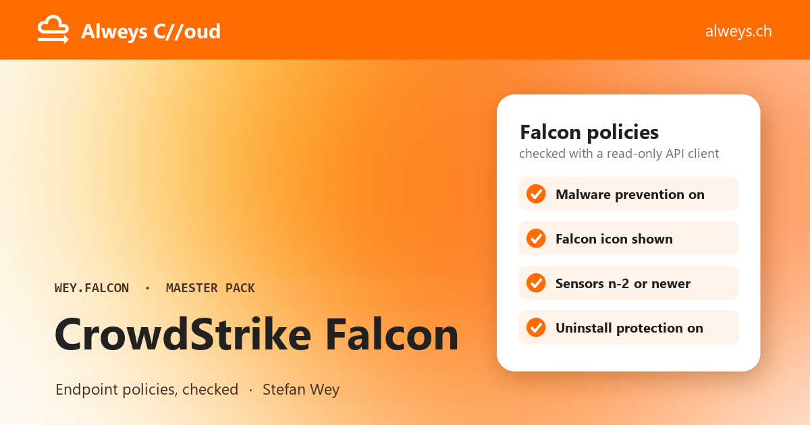

# CrowdStrike Falcon Maester pack

**by [Alweys C//oud](https://www.alweys.ch): ensure that your cloud is always oriented the right way.**

A [Maester Pack](https://maester.dev/docs/next/packs) that checks the policies of a
[CrowdStrike Falcon](https://www.crowdstrike.com) tenant. It reads the Falcon API with a read-only API client
through the [PSFalcon](https://github.com/CrowdStrike/psfalcon) module and changes nothing.

Not made by or affiliated with CrowdStrike.

## Try it

```powershell
Install-MtPack weyCC81/ch.alweys.maester-pack-wey/crowdstrike
```

In the Falcon console, create an API client under **Support and resources > API clients and keys** with **Read**
on **Prevention policies** and **Sensor update policies**, and nothing else. Then connect and run, with the cloud
of your CID (`us-1`, `us-2`, `eu-1`, `us-gov-1` or `us-gov-2`):

```powershell
Connect-Maester -Service WEY.FALCON.Api -ServiceSetting @{ ClientId = '<client id>'; ClientSecret = (Read-Host -AsSecureString 'Falcon client secret'); Cloud = 'eu-1' }

# A child CID in Flight Control (multi-CID)
Connect-Maester -Service WEY.FALCON.Api -ServiceSetting @{ ClientId = '<client id>'; ClientSecret = (Read-Host -AsSecureString 'Falcon client secret'); Cloud = 'us-1'; MemberCid = '<child CID>' }

Invoke-Maester -Pack WEY.FALCON -SkipBuiltIn
```

For unattended runs, set `MAESTER_WEY_FALCON_API_CLIENTID`, `MAESTER_WEY_FALCON_API_CLIENTSECRET` and
`MAESTER_WEY_FALCON_API_CLOUD` (and `MAESTER_WEY_FALCON_API_MEMBERCID` for a child CID). Keep the secret out of
`maester-config.json`. Without a connection the tests are skipped; a test whose scope the API client lacks is
skipped and names the scope.

## Tests

| ID | What it checks |
| --- | --- |
| MP.WEY.FALCON.1001 | One result per enabled prevention policy: Cloud-based anti-malware, Cloud anti-malware for Microsoft Office files and Sensor-based anti-malware prevent at Moderate or higher, and Show Falcon icon is on |
| MP.WEY.FALCON.1002 | One result per enabled sensor update policy: sensor version updates are on, at n-2 or newer (automatic or pinned), and uninstall protection is on (Windows and Mac) |

Change the settings in your `maester-config.json`, or leave out a policy:

```json
{
  "TestSettings": [
    { "Id": "MP.WEY.FALCON.1001", "Parameters": { "MinimumPreventionLevel": "AGGRESSIVE", "RequireFalconIcon": false } },
    { "Id": "MP.WEY.FALCON.1002", "Parameters": { "MaximumReleasesBehind": 1 } }
  ]
}
```

## What the pack reaches

`Uses` in [maester-pack.json](maester-pack.json) declares it, and Install-MtPack shows it before installing:

- **Service**: `WEY.FALCON.Api`, the pack's own connector ([connector/Connect-WeyFalcon.ps1](connector/Connect-WeyFalcon.ps1)).
- **Module**: PSFalcon 2.2.9 from the PowerShell Gallery, saved and pinned by Maester at install. The pack uses
  only its token and reading commands: `Request-FalconToken`, `Test-FalconToken`, `Get-FalconPreventionPolicy`,
  `Get-FalconSensorUpdatePolicy` and `Get-FalconBuild`
  ([helpers/Invoke-WeyFalconRequest.ps1](helpers/Invoke-WeyFalconRequest.ps1)).
- **Network**: the Falcon API host of your cloud, through the module: `api.crowdstrike.com`,
  `api.us-2.crowdstrike.com`, `api.eu-1.crowdstrike.com`, `api.laggar.gcw.crowdstrike.com` or
  `api.us-gov-2.crowdstrike.mil`.
- **Tenant writes and Graph scopes**: none.

## Develop

```powershell
Test-MtPack .
Invoke-MtTest -Path .
```

Write what changed under `## Unreleased` in [CHANGELOG.md](CHANGELOG.md) and raise `Version` in
`maester-pack.json`. A test is a Maester native test: see
[Writing native tests](https://maester.dev/docs/next/writing-tests/) and
[Writing a pack](https://maester.dev/docs/next/packs/writing-a-pack).

## Files

| Path | What it is |
| --- | --- |
| `maester-pack.json` | The manifest: ID, code, version, the suite, helpers, the connector and what the pack uses |
| `maester-pack.guide.json` | How to install, connect and run, for the pack's page on packs.maester.cloud |
| `tests/` | The suite: `suite.json`, and one `Test.<ID>.ps1` and `Test.<ID>.md` per test |
| `helpers/` | Giving the loaded PSFalcon module a token, reading with a scope check, and plain-text names |
| `connector/` | `Connect-`, `Test-` and `Disconnect-WEYFalcon` |
| `assets/banner.png` | The image the pack index shows when it features the pack |

Security issues: see the [security policy](../SECURITY.md).

## About

Made by Stefan Wey, trainer and solution engineer at [Alweys C//oud](https://www.alweys.ch), who writes there about
Microsoft 365 mail security, identity and collaboration.
