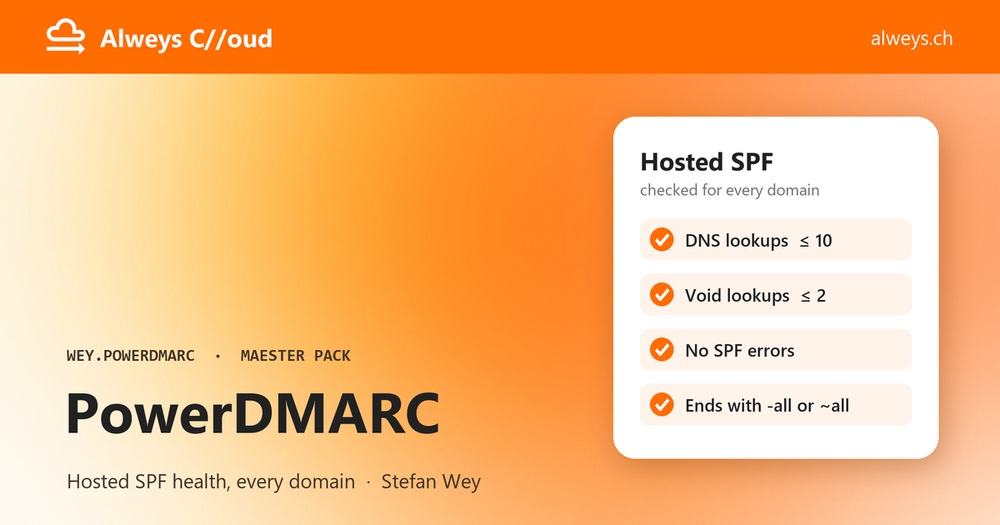

# PowerDMARC Maester pack

**by [Alweys C//oud](https://www.alweys.ch): ensure that your cloud is always oriented the right way.**

A [Maester Pack](https://maester.dev/docs/next/packs) that checks the email authentication
[PowerDMARC](https://powerdmarc.com) manages for your domains. It reads through the PowerDMARC API with the
[PowerDMARC](https://www.powershellgallery.com/packages/PowerDMARC) PowerShell module and changes nothing.

Not made by or affiliated with PowerDMARC.

## Try it

```powershell
Install-MtPack weyCC81/ch.alweys.maester-pack-wey/powerdmarc
```

Create a Personal Access Token in PowerDMARC under **API Settings > Personal Access Tokens** (MSSP administrators:
**API Settings > Manage API Tokens**), then connect and run the pack:

```powershell
# End user (Default mode): the domains of the token's own account
Connect-Maester -Service WEY.POWERDMARC.Api -ServiceSetting @{ ApiToken = (Read-Host -AsSecureString 'PowerDMARC token') }

# Reseller (MSSP mode) on your portal host: one customer account, or leave AccountId out for every account
Connect-Maester -Service WEY.POWERDMARC.Api -ServiceSetting @{
    ApiToken  = (Read-Host -AsSecureString 'PowerDMARC token')
    Mode      = 'Reseller'
    BaseUri   = 'reseller.powerdmarc.com'
    AccountId = 42
}

Invoke-Maester -Pack WEY.POWERDMARC -SkipBuiltIn
```

For unattended runs, put the token in the `MAESTER_WEY_POWERDMARC_API_APITOKEN` environment variable (and
`..._MODE`, `..._BASEURI`, `..._ACCOUNTID` as needed) instead of `-ServiceSetting`. Keep it out of
`maester-config.json`. Without a connection the tests are skipped.

| Setting | Default | What it does |
| --- | --- | --- |
| `ApiToken` | (required) | The Personal Access Token, as a SecureString or a string |
| `Mode` | `Default` | `Default` (End User API) or `Reseller` (MSSP API) |
| `BaseUri` | `app.powerdmarc.com` | The PowerDMARC host; resellers use their own portal host |
| `AccountId` | `0` | Reseller mode: the customer account to check; `0` checks every customer account |

## Tests

| ID | What it checks |
| --- | --- |
| MP.WEY.POWERDMARC.1001 | One result per domain: the Hosted SPF (PowerSPF) record needs at most 10 DNS lookups and at most 2 void lookups, has no errors, and ends with `-all` or `~all`. Domains without Hosted SPF are skipped |

Each domain gets its own result, `MP.WEY.POWERDMARC.1001.<domain>`. In Reseller mode each result has the field
**Account**, the customer account it belongs to, so the report groups and filters the domains by customer. A domain
that two customer accounts hold gets the account ID at the end: `MP.WEY.POWERDMARC.1001.<domain>.<account ID>`.

Change the limits in your `maester-config.json`, for every domain or for one, or leave a domain out:

```json
{
  "TestSettings": [
    { "Id": "MP.WEY.POWERDMARC.1001", "Parameters": { "MaximumLookups": 8, "MaximumVoidLookups": 2, "RequireHardFail": true } },
    { "Id": "MP.WEY.POWERDMARC.1001.contoso.com", "Parameters": { "RequireHardFail": false } },
    { "Id": "MP.WEY.POWERDMARC.1001.contoso.onmicrosoft.com", "Enabled": false }
  ]
}
```

## What the pack reaches

`Uses` in [maester-pack.json](maester-pack.json) declares it, and Install-MtPack shows it before installing:

- **Service**: `WEY.POWERDMARC.Api`, the pack's own connector
  ([connector/Connect-WeyDmarcPowerDmarc.ps1](connector/Connect-WeyDmarcPowerDmarc.ps1)).
- **Module**: PowerDMARC 0.1.1 from the PowerShell Gallery, saved and pinned by Maester at install.
- **Network**: `*.powerdmarc.com`, through the module. The module sends only `GET` requests.
- **Tenant writes and Graph scopes**: none.

## Develop

Check the pack and run its tests from this folder:

```powershell
Test-MtPack .
Invoke-MtTest -Path .
```

[check-pack.yml](../.github/workflows/check-pack.yml) does the same on every push and pull request. Write what
changed under `## Unreleased` in [CHANGELOG.md](CHANGELOG.md) and raise `Version` in `maester-pack.json`.

A test is a Maester native test: see [Writing native tests](https://maester.dev/docs/next/writing-tests/) and
[Writing a pack](https://maester.dev/docs/next/packs/writing-a-pack).

## Files

| Path | What it is |
| --- | --- |
| `maester-pack.json` | The manifest: ID, code, version, the suite, helpers, the connector and what the pack uses |
| `tests/` | The suite: `suite.json`, and one `Test.<ID>.ps1` and `Test.<ID>.md` per test |
| `helpers/` | Functions the tests call: `Get-WeyDmarcDomain` lists the domains in scope with their customer account, and `Connect-WeyDmarcPowerDmarcModule` connects the loaded PowerDMARC module |
| `connector/` | `Connect-`, `Test-` and `Disconnect-WeyDmarcPowerDmarc` for the PowerDMARC API |
| `assets/banner.png` | The image the pack index shows when it features the pack |

Security issues: see the [security policy](../SECURITY.md).

## About

Made by Stefan Wey, trainer and solution engineer at [Alweys C//oud](https://www.alweys.ch), who writes there about
Microsoft 365 mail security, identity and collaboration. Also by Alweys C//oud: the
[PowerDMARC PowerShell module](https://www.powershellgallery.com/packages/PowerDMARC) this pack uses.
