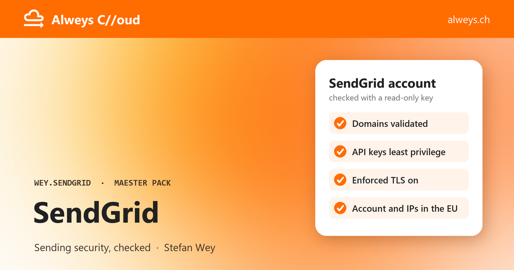

# SendGrid Maester pack

**by [Alweys C//oud](https://www.alweys.ch): ensure that your cloud is always oriented the right way.**

A [Maester Pack](https://maester.dev/docs/next/packs) that checks the security of a
[Twilio SendGrid](https://sendgrid.com) account. It reads the SendGrid API with a read-only API key through the
[SendGridTools](https://www.powershellgallery.com/packages/SendGridTools) module and changes nothing.

Not made by or affiliated with Twilio or SendGrid.

## Limits

- **Global SendGrid API only.** SendGridTools 0.4.7 reaches only `api.sendgrid.com`. An **EU regional account or
  subuser** (`api.eu.sendgrid.com`, EU data residency) cannot be connected, so none of the tests can check it. The
  connector refuses `Region = 'EU'` with a message instead of failing later.
- MP.WEY.SENDGRID.1004 therefore checks the subusers and dedicated IPs of a global account, not the account
  itself, which is always global.
- Dedicated IPs are read in one page of up to `MaximumIps` (1000), because SendGridTools does not return the
  paging marker of `/v3/send_ips/ips`.

These limits are reported to SendGridTools; the pack will drop them once the module supports the EU API.

## Try it

```powershell
Install-MtPack weyCC81/ch.alweys.maester-pack-wey/sendgrid
```

In SendGrid, create an API key under **Settings > API Keys > Create API Key > Restricted Access** with **read**
access to Domain Authentication (`whitelabel.read`), API Keys (`api_keys.read`), Enforced TLS
(`user.settings.enforced_tls.read`), Subusers (`subusers.read`) and IP Addresses (`ips.read`). Then connect and run:

```powershell
Connect-Maester -Service WEY.SENDGRID.Api -ServiceSetting @{ ApiKey = (Read-Host -AsSecureString 'SendGrid API key') }
Invoke-Maester -Pack WEY.SENDGRID -SkipBuiltIn
```

For unattended runs, put the key in the `MAESTER_WEY_SENDGRID_API_APIKEY` environment variable. Keep it out of
`maester-config.json`. Without a connection the tests are skipped; a test whose scope the key lacks is skipped and
names the scope.

## Tests

| ID | What it checks |
| --- | --- |
| MP.WEY.SENDGRID.1001 | One result per authenticated domain: SendGrid has validated its DKIM and SPF records, so mail passes DKIM and aligns with DMARC |
| MP.WEY.SENDGRID.1002 | One result per API key: no Full Access, no scopes that manage access to the account, at most 60 scopes |
| MP.WEY.SENDGRID.1003 | Enforced TLS is on, at TLS 1.2 or newer (a valid certificate is optional) |
| MP.WEY.SENDGRID.1004 | The subusers and dedicated IPs of the (global) account are in the EU region |

Change the settings in your `maester-config.json`, or leave out a domain or key:

```json
{
  "TestSettings": [
    { "Id": "MP.WEY.SENDGRID.1002", "Parameters": { "MaximumScopes": 20 } },
    { "Id": "MP.WEY.SENDGRID.1003", "Parameters": { "RequireValidCertificate": true, "MinimumVersion": "1.2" } },
    { "Id": "MP.WEY.SENDGRID.1004", "Enabled": false }
  ]
}
```

Turn off MP.WEY.SENDGRID.1004 if your organisation does not need its mail data in the EU.

## What the pack reaches

`Uses` in [maester-pack.json](maester-pack.json) declares it, and Install-MtPack shows it before installing:

- **Service**: `WEY.SENDGRID.Api`, the pack's own connector ([connector/Connect-WeySendGrid.ps1](connector/Connect-WeySendGrid.ps1)).
- **Module**: SendGridTools 0.4.7 from the PowerShell Gallery, saved and pinned by Maester at install. The pack
  uses only its reading commands (`Connect-SendGrid`, `Get-SGPermissionScopes`, `Get-SGApiKey`, and
  `Invoke-SGCommand` with GET) ([helpers/Invoke-WeySendGridRequest.ps1](helpers/Invoke-WeySendGridRequest.ps1)).
- **Network**: `api.sendgrid.com`, through the module.
- **Tenant writes and Graph scopes**: none.

## Develop

```powershell
Test-MtPack .
Invoke-MtTest -Path .
```

Write what changed under `## Unreleased` in [CHANGELOG.md](CHANGELOG.md) and raise `Version` in
`maester-pack.json`. A test is a Maester native test: see
[Writing native tests](https://maester.dev/docs/next/writing-tests/) and
[Writing a pack](https://maester.dev/docs/next/packs/writing-a-pack).

## Files

| Path | What it is |
| --- | --- |
| `maester-pack.json` | The manifest: ID, code, version, the suite, helpers, the connector and what the pack uses |
| `maester-pack.guide.json` | How to install, connect and run, for the pack's page on packs.maester.cloud |
| `tests/` | The suite: `suite.json`, and one `Test.<ID>.ps1` and `Test.<ID>.md` per test |
| `helpers/` | Connecting the loaded SendGridTools module, paging through `Invoke-SGCommand` and the scope check |
| `connector/` | `Connect-`, `Test-` and `Disconnect-WEYSendGrid` |
| `assets/banner.png` | The image the pack index shows when it features the pack |

Security issues: see the [security policy](../SECURITY.md).

## About

Made by Stefan Wey, trainer and solution engineer at [Alweys C//oud](https://www.alweys.ch), who writes there about
Microsoft 365 mail security, identity and collaboration.
